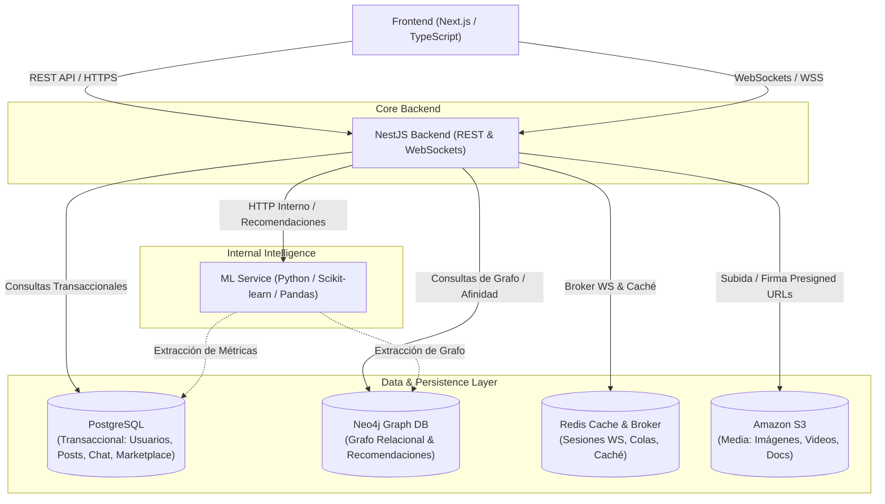

# Promexa

Plataforma social, Marketplace y mensajería en tiempo real con motor de recomendaciones inteligente.

---

## 🏛️ Arquitectura del Sistema

El sistema implementa un modelo **cliente-servidor desacoplado** apoyado en APIs REST y canales WebSocket:



---

## 📂 Estructura del Repositorio

```
Promexa/
├── apps/
│   ├── web/                          # Frontend Next.js (TypeScript)
│   │   ├── src/
│   │   │   ├── app/                  # App Router (auth, feed, marketplace, chat, profile)
│   │   │   ├── components/           # Componentes UI reutilizables
│   │   │   ├── hooks/                # Custom React Hooks
│   │   │   ├── lib/                  # Clientes API REST y WebSocket
│   │   │   ├── types/                # Tipos TypeScript
│   │   │   └── styles/               # Estilos globales y tokens
│   │   └── public/                   # Recursos estáticos
│   │
│   ├── api/                          # Backend NestJS (TypeScript)
│   │   ├── src/
│   │   │   ├── common/               # Guards, decoradores, filtros, interceptores
│   │   │   ├── config/               # Manejo de variables de entorno y validación
│   │   │   ├── database/             # Conectores PostgreSQL y Neo4j
│   │   │   ├── cache/                # Integración Redis
│   │   │   ├── websockets/           # Gateways y socket adapters en tiempo real
│   │   │   └── modules/
│   │   │       ├── auth/             # Autenticación y JWT
│   │   │       ├── users/            # Gestión de usuarios y perfiles
│   │   │       ├── posts/            # Feed social, comentarios y reacciones
│   │   │       ├── marketplace/      # Productos, categorías y transacciones
│   │   │       ├── chat/             # Mensajería instantánea y salas
│   │   │       ├── notifications/    # Notificaciones en tiempo real
│   │   │       ├── storage/          # Integración con Amazon S3
│   │   │       └── recommendation-client/ # Cliente hacia el ML Service
│   │   └── test/                     # Tests unitarios y e2e
│   │
│   └── ml-service/                   # Servicio de Recomendaciones (Python)
│       ├── app/
│       │   ├── api/                  # Endpoints FastAPI
│       │   ├── core/                 # Configuración y seguridad interna
│       │   ├── models/               # Modelos Scikit-learn
│       │   ├── pipelines/            # Pipelines de datos con Pandas
│       │   └── services/             # Lógica de cálculo de recomendaciones
│       ├── tests/                    # Tests de modelos y endpoints
│       └── requirements.txt          # Dependencias Python
│
├── docker/                           # Scripts y configuraciones Docker
│   ├── postgres/
│   ├── neo4j/
│   └── redis/
│
├── infra/                            # Infraestructura como código y guías
│   └── aws/                          # Configuraciones para AWS (ECS, S3, RDS, ElastiCache)
│
├── .github/
│   └── workflows/                    # Pipelines de CI/CD (GitHub Actions)
│       └── ci.yml
│
├── docs/                             # Documentación de arquitectura y modelo de datos
│   └── architecture/
│
├── docker-compose.yml                # Orquestación de servicios para desarrollo local
├── .env.example                      # Plantilla de variables de entorno
└── .gitignore                        # Reglas de exclusión para Git
```

---

## 🚀 Inicio Rápido (Entorno Local)

### 1. Clonar y configurar variables de entorno
```bash
cp .env.example .env
```

### 2. Levantar bases de datos y servicios con Docker
```bash
docker-compose up -d postgres neo4j redis
```

- **PostgreSQL**: `localhost:5432`
- **Neo4j Browser UI**: `http://localhost:7474` (Bolt: `localhost:7687`)
- **Redis**: `localhost:6379`
